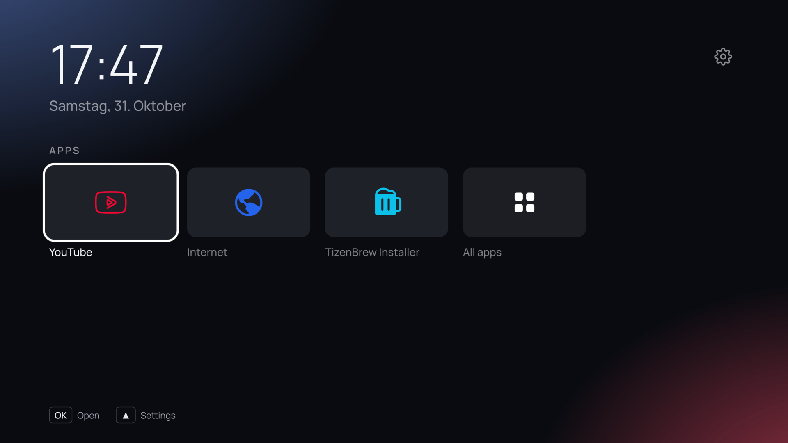

# Arn0 Launcher

A quieter home screen for a Samsung Tizen TV: just the apps row and a screensaver.



This is a personal fork of [arn0-tv](https://github.com/arn0/arn0-tv), heavily trimmed down to be minimalistic. Built for Samsung S95BA (QE65S95BATXXN, T-PTMDEUC-1720.7). It uses `webapis.appcommon.setScreenSaver` (with periodic re-apply) to disable Samsung's own system screensaver so only the launcher's screensaver shows. Locale is `de-DE`; the date language offers Deutsch and English.

**Use it at your own risk.** Installing the launcher changes nothing about how the TV behaves; the optional Home-button change (below) does. See [docs/setup-tv.md](docs/setup-tv.md) before using it.

## Commands

```sh
npm run preview      # browser preview on :8080 (arrows + Enter, Esc = Back)
npm run build        # -> dist/arn0-launcher.wgt
npm run devlog       # receive Lab logs from the TV into logs/tv.jsonl
node scripts/prepare-wallpapers.mjs <folder>   # regenerate wallpapers from your photos
```

Needs Node.js 20+. The preview runs against `src/js/tizen-mock.js`, a stand-in for the Tizen APIs,
so layout, focus behaviour, settings and wallpapers are all real while app launching is faked.

## Install on the TV

1. Enable **Developer Mode** on the TV (Samsung account not needed for this): many TVs take pin
   `12345`; [Apps2Samsung's FAQ](https://github.com/Apps2Samsung/Apps2Samsung/wiki/FAQ) has the
   exact steps per model and firmware.
2. `npm run build` produces `dist/arn0-launcher.wgt` (unsigned; it is signed at install time).
3. Install it with [Apps2Samsung](https://apps2samsung.com/) — the Custom WGT option — or the
   Tizen Studio CLI. First install asks for a Samsung sign-in once, to create the author
   certificate. Updating later must use the same certificate; uninstall clears saved settings.
4. Open it from the Samsung app list. Verify: apps launch, Settings survives a TV restart.

Installing is fully reversible by uninstalling. The launcher works fine opened from the app list
like any other app.

## Home button (optional)

The Home button can be pointed at the launcher, but that path edits TV preferences Samsung does
not document, needs `sdb` on the network, and is only reversible with a saved per-device
baseline. It is deliberately not part of this install: **[docs/setup-tv.md](docs/setup-tv.md)**
covers what it does, its guards, and recovery. Everything there keeps a route back to the TV's
own menus, through the launcher's Settings → Samsung Home entry.

## What you can change

- [`src/js/config.js`](src/js/config.js) — apps on the Home row, locale, theme, weather, sound.
- [`src/js/config.local.js`](src/js/config.local.example.js) — gitignored per-TV overrides
  (weather coordinates, devlog address, locale), merged one level deep over `config.js`. Copy
  `config.local.example.js` to start. Anything personal belongs there, not in `config.js`.
- [`src/js/brands.js`](src/js/brands.js) — tile colours and brand marks.
- [`src/css/style.css`](src/css/style.css) — the whole look.
- Your own photos as wallpapers: `node scripts/prepare-wallpapers.mjs <folder>`.

Once the launcher is on the TV, most of this is also editable from its own Settings, which the
TV remembers: background (off / photo / rotate), which apps are on Home and in which order,
appearance (clock, date, font), navigation sound, screen saver timings.

## Remote

| Key | Action |
| --- | --- |
| Arrows | move (Up from the apps row reaches the gear = Settings) |
| OK | open app / select |
| Back | one level back (does nothing on Home) |

Hidden: Red = All apps, Green = next wallpaper, Yellow = toggle system apps / the game,
Blue = Lab (developer tests and probes). On Home, ◀ ▶ alternating three times starts the game.

## Notes worth keeping

- **Weather** — from Open-Meteo (no key, non-commercial licence) for the coordinates in
  `config.local.js`; off until they are set. Cached in `localStorage`, refreshed at most hourly,
  treated as stale after three hours.
- **Screen saver** — after idle minutes on Home: wallpapers full screen with clock, weather and
  photo name; everything moves (burn-in safety). On S95BA, `webapis.appcommon.setScreenSaver` is called (and re-applied periodically) to disable Samsung's system screensaver so only the launcher's screensaver appears. Any key closes it. A web app cannot switch the panel off: the TV's own Eco Solution ▸ Auto Power Off does that.
- **App list** — `getAppsInfo` includes system services, so the list is filtered to look like
  store apps. Yellow shows everything; the focused app's id is shown bottom-left, which is the
  reliable thing to pin into `config.js`.
- **Performance** — the Lab screen measures what the TV renders (fps, dropped frames, engine and
  CSS support) rather than guessing. Rules of thumb measured on the reference hardware: plain
  shadows are fine, live gradient layers are not; the readability scrim of a wallpaper is baked
  at build time so the TV only draws finished JPEGs.

## Licence and credits

MIT for the original code and documentation — see [LICENSE](LICENSE). Bundled fonts (OFL),
Unsplash photos and brand marks keep their own terms — see
[`src/img/marks/SOURCES.md`](src/img/marks/SOURCES.md). Weather data by
[Open-Meteo](https://open-meteo.com/). Brand names and logos belong to their owners. This
project is independent and not affiliated with Samsung or any streaming service.
